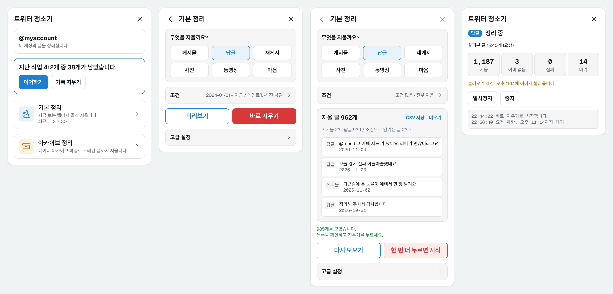
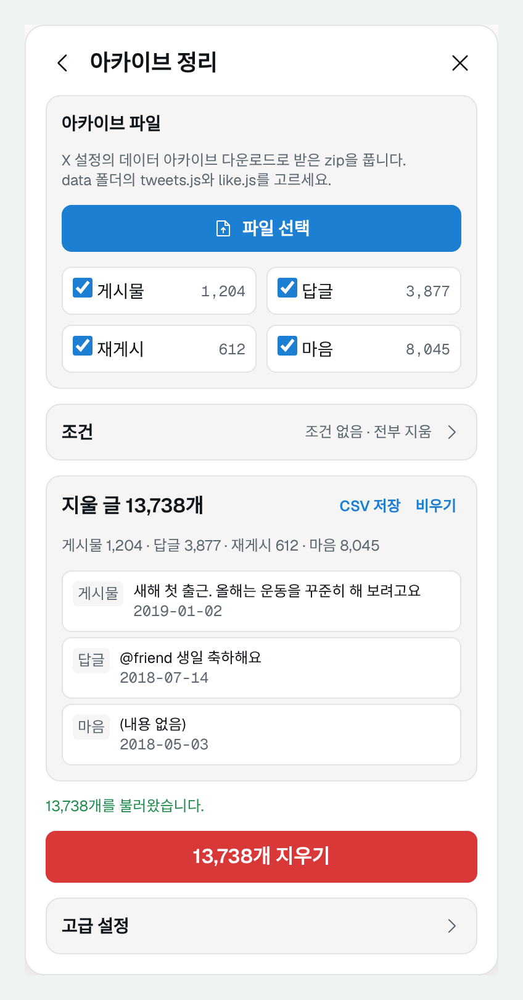

# 트위터 청소기

X(트위터)에 올린 게시물·답글·재게시·사진·동영상과 누른 마음을 조건에 맞춰 한꺼번에 지우는 크롬 확장 프로그램입니다.
유료 API 키 없이, 브라우저에 로그인한 x.com 계정 그대로 동작합니다.



## 주요 기능

- **기본 정리**: 게시물, 답글, 재게시, 사진, 동영상, 마음 중 골라서 최근 약 3,200개까지 정리
- **아카이브 정리**: X 데이터 아카이브 파일(`tweets.js`, `like.js`)로 오래된 글까지 전부 정리
- **미리보기**와 **바로 지우기** 두 가지 방식
- **조건**: 기간, 특정 단어가 있는 글만 지우기, 남길 글 지정(메인트윗, 내가 마음 누른 글, 사진·동영상 있는 글, 특정 단어, 마음 N개 이상, 특정 글)
- **안전장치**: 지우기 버튼은 두 번 눌러야 시작, 요청 제한에 걸리면 자동으로 기다렸다 이어서 진행, 탭을 닫아도 다음에 이어하기
- 실패한 글 목록과 지울 글 목록을 CSV로 저장

## 설치

크롬 웹 스토어에 올라가 있지 않아서 직접 설치합니다. 크롬과 엣지 등 크로뮴 기반 브라우저에서 쓸 수 있습니다.

1. 이 저장소의 [Releases](../../releases)에서 최신 `x-cleaner.zip`을 내려받아 압축을 풉니다.
   저장소 오른쪽 위 **Code → Download ZIP**으로 받아도 됩니다.
2. 주소창에 `chrome://extensions`를 입력합니다. 엣지는 `edge://extensions`입니다.
3. 오른쪽 위(엣지는 왼쪽 아래)의 **개발자 모드**를 켭니다.
4. **압축해제된 확장 프로그램을 로드합니다**를 누르고, 압축을 푼 폴더 중 `manifest.json`이 들어 있는 폴더를 고릅니다.
5. 툴바의 퍼즐 모양 아이콘에서 트위터 청소기 옆 핀을 눌러 고정하면 쓰기 편합니다.

> 압축을 푼 폴더를 지우면 확장도 사라집니다. 지우지 않을 곳에 두세요.
> 브라우저를 켤 때 "개발자 모드 확장 프로그램 사용 중지" 안내가 뜰 수 있습니다. 닫기를 누르면 계속 쓸 수 있습니다.

### 업데이트

새 버전 zip을 받아 기존 폴더에 덮어쓴 뒤, `chrome://extensions`에서 트위터 청소기의 새로고침(↻)을 누릅니다.
**열려 있던 x.com 탭도 꼭 새로고침하세요.** 새로고침하지 않으면 이전 버전이 계속 돌아갑니다.

## 사용 방법

x.com에 정리할 계정으로 로그인한 뒤, x.com 탭에서 툴바의 트위터 청소기 아이콘을 누르면 오른쪽에 패널이 열립니다.
첫 화면에서 **기본 정리**와 **아카이브 정리** 중 하나를 고릅니다.

### 기본 정리 (최근 약 3,200개)

1. **무엇을 지울까요?** 에서 게시물·답글·재게시·사진·동영상·마음 중 하나를 누릅니다. 그 탭으로 이동하고 버튼이 파랗게 표시됩니다.
2. 필요하면 **조건**을 펼쳐 정합니다. 접힌 상태에서도 정한 조건이 한 줄로 보입니다.
3. 방식을 고릅니다.
   - **미리보기**: 지울 글을 끝까지 모아 목록으로 보여 줍니다. 확인한 뒤 **N개 지우기**를 누릅니다.
   - **바로 지우기**: 목록을 모으지 않고, 불러오는 대로 조건에 맞는 글을 바로 지웁니다.
4. 지우기 버튼은 한 번 누르면 **"한 번 더 누르면 시작"** 으로 바뀝니다. 4초 안에 한 번 더 눌러야 시작합니다.

X는 프로필에서 최근 약 3,200개까지만 보여 줍니다. 그보다 오래된 글은 아카이브 정리를 쓰세요.

### 아카이브 정리 (오래된 글까지)



1. x.com에서 **설정 및 개인정보 → 내 계정 → 데이터 아카이브 다운로드**로 아카이브를 신청합니다. 준비되기까지 하루 이상 걸릴 수 있습니다.
2. 받은 zip의 압축을 풉니다.
3. 패널에서 **아카이브 정리 → 파일 선택**을 누르고, `data` 폴더의 `tweets.js`와 `like.js`를 함께 고릅니다. `tweets-part1.js`처럼 나뉘어 있으면 모두 고르세요.
4. 지울 종류(게시물, 답글, 재게시, 마음)와 조건을 정한 뒤 **N개 지우기**를 두 번 누릅니다.

### 조건

| 조건 | 설명 |
|---|---|
| 기간 | `2024-01-01` 또는 `20240101`처럼 입력합니다. 마음은 원글이 올라온 날 기준입니다. |
| 이 단어가 있는 글만 | 적은 단어가 하나라도 들어간 글만 지웁니다. 쉼표로 여러 개 적을 수 있습니다. |
| 메인트윗 | 프로필에 고정한 글을 남깁니다. 확인에 실패하면 정리를 시작하지 않습니다. |
| 내가 마음 누른 글 | 내 글 중 내가 직접 마음을 누른 글을 남깁니다. |
| 사진 있는 글 / 동영상 있는 글 | 직접 올린 사진이나 동영상(움직이는 GIF 포함)이 있는 글을 남깁니다. 인용한 글의 미디어는 세지 않습니다. |
| 이 단어가 있는 글 | 적은 단어가 들어간 글을 남깁니다. |
| 마음 이만큼 이상 받은 글 | 마음을 N개 이상 받은 글을 남깁니다. |
| 특정 글 | 글 주소나 ID를 적으면 그 글을 남깁니다. 여러 개 적을 수 있습니다. |

### 진행 화면

정리를 시작하면 패널이 진행 화면으로 바뀝니다.

- **지움 · 이미 없음 · 실패 · 대기** 현황과 지금 정리 중인 종류가 보입니다.
- **일시정지**와 **중지**를 누를 수 있습니다. 중지하면 지금 처리 중인 글까지만 지우고 멈춥니다.
- 끝나면 결과가 나오고, 실패한 글이 있으면 **실패 CSV**로 저장하거나 **실패 재시도**를 누를 수 있습니다.
- 진행 중에 탭을 닫았다면, 다음에 패널을 열 때 첫 화면에서 **이어하기**를 누르세요.

### 고급 설정

| 설정 | 설명 |
|---|---|
| 최소·최대 간격 | 글을 하나 지울 때마다 쉬는 시간입니다. 기본 2~5초입니다. 너무 줄이면 요청 제한에 더 자주 걸립니다. |
| 삭제 방식 | **자동**은 X 웹이 쓰는 요청으로 지우고, 막히면 화면을 직접 누르는 방식으로 바꿉니다. **화면 조작**은 처음부터 화면을 누릅니다. 느리지만 X 구조가 바뀌어도 버티는 편입니다. |
| 안 지워지는 마음은 다시 눌렀다 취소 | 마음을 정리할 때만 보입니다. 오래된 마음이 취소되지 않으면 켜세요. |

## 속도와 요청 제한

X는 짧은 시간에 너무 많은 요청을 보내면 잠시 막습니다. 트위터 청소기는 이렇게 대응합니다.

- 목록은 스크롤 없이 X 웹의 목록 요청으로 20개씩 불러옵니다. 15분에 1,000개 정도 불러오면 제한에 걸립니다.
- 제한에 걸리면 풀리는 시각을 보여 주고, 그때까지 기다렸다가 자동으로 이어 갑니다. 탭만 열어 두면 됩니다.
- 150개를 지울 때마다 1분 안팎으로 쉬어 갑니다.

글이 수천 개 이상이면 기간을 나눠 여러 번에 걸쳐 정리하는 것을 권합니다.

## 문제 해결

**아이콘을 눌러도 패널이 안 열려요**
x.com 탭을 새로고침한 뒤 다시 누르세요. 확장을 설치하거나 업데이트하기 전부터 열려 있던 탭에는 확장이 붙어 있지 않습니다.

**진행 문구에 "스크롤"이라고 나와요**
요청으로 불러오기가 막혀 화면을 스크롤하는 방식으로 바뀐 것입니다. 정리는 계속되지만 느려집니다. 이때는 화면을 직접 스크롤하거나 다른 탭으로 옮기지 마세요. 지나간 글이 빠질 수 있습니다. 탭을 새로고침한 뒤 다시 시작하면 요청 방식으로 돌아오는 경우가 많습니다.

**"메인트윗을 확인하지 못했습니다"가 떠요**
페이지를 새로고침한 뒤 조건의 메인트윗을 다시 체크하세요.

**아무것도 지워지지 않아요**
정리할 계정으로 로그인했는지 확인하세요. 첫 화면에 지금 로그인한 계정이 표시됩니다. 다른 계정의 프로필에서는 지울 글을 찾지 못합니다.

**마음이 취소되지 않아요**
고급 설정에서 "안 지워지는 마음은 다시 눌렀다 취소"를 켜고 다시 해 보세요.

**3,200개보다 오래된 글이 안 보여요**
X가 프로필에서 그 이상은 보여 주지 않습니다. 아카이브 정리를 쓰세요.

## 동작 방식

- x.com에 로그인한 브라우저 안에서, X 웹사이트가 쓰는 것과 같은 요청으로 목록을 불러오고 글을 지웁니다.
- X는 목록 요청의 이름과 형식을 자주 바꿉니다. 그래서 고정된 값을 쓰지 않고, X 웹이 그 탭에서 실제로 보낸 요청을 보고 그대로 따라 합니다.
- 요청이 막히면 화면을 스크롤하거나 버튼을 누르는 방식으로 자동 전환합니다.

## 개인정보

- 모든 처리는 내 브라우저 안에서만 이루어집니다. 글, 아카이브 파일, 로그인 정보를 다른 서버로 보내지 않습니다.
- 통신하는 곳은 x.com과 X의 웹 파일 서버(abs.twimg.com)뿐입니다.
- 진행 상황은 이어하기를 위해 브라우저의 확장 저장소에만 저장됩니다. 첫 화면의 **기록 지우기**로 지울 수 있습니다.

## 주의

- **지운 글은 되돌릴 수 없습니다.** 처음에는 기간을 좁혀 몇 개만 지워 보고, 필요하면 미리보기의 **CSV 저장**으로 목록을 남겨 두세요.
- X 공식 도구가 아닙니다. 자동화는 X 이용약관상 회색지대이며, 많이 지우면 계정에 일시적인 제한이 걸릴 수 있습니다. 사용에 따른 책임은 사용자에게 있습니다.
- X가 웹사이트 구조를 바꾸면 일부 기능이 동작하지 않을 수 있습니다.

## 파일 구성

```
manifest.json       확장 설정 (Manifest V3)
background.js       툴바 아이콘 처리, X 웹 파일에서 요청 정보 찾기
src/hook.js         X 웹이 보내는 목록 요청을 기록
src/api.js          목록 불러오기와 삭제 요청
src/collector.js    요청으로 불러오기, 막히면 스크롤로 전환
src/dom.js          화면에서 글 찾기, 화면 조작으로 지우기
src/archive.js      아카이브 읽기, 조건 걸러내기, CSV
src/engine.js       삭제 대기열, 속도 조절, 진행 저장
src/panel.js        패널 화면
fonts/              Geist 글꼴
icons/              아이콘
```

## 라이선스

포함된 Geist 글꼴은 SIL Open Font License 1.1을 따릅니다([fonts/LICENSE-Geist.txt](fonts/LICENSE-Geist.txt)).
